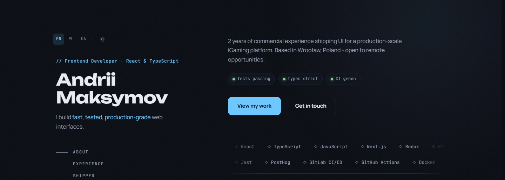

# Portfolio

[](https://github.com/MaksymovAndrew/portfolio/actions/workflows/ci.yml) [](LICENSE)

The personal site of Andrii Maksymov, frontend developer: one page in English, Polish and Ukrainian, generated ahead of time with Next.js.

<picture>
    <source media="(prefers-color-scheme: light)" srcset="docs/screenshots/light.png">
    
</picture>

Live at <https://andrii-maksymov.tech>.

## What is inside

- **Static pages.** Every language is a page built ahead of time and served as a file; the icons and the link previews are drawn at build time too. At request time the server only picks the language page for the address.
- **Three languages, one address each.** English at `/`, Polish at `/pl`, Ukrainian at `/uk`, each with its own title, description, canonical address, language alternates, structured data and link preview.
- **Two themes.** Dark and light, remembered and applied before the first paint, switched with a circle growing from the button.
- **Accessibility.** WCAG 2.2 AA in both themes: keyboard, visible focus, checked contrast, reduced motion, a pause for everything that moves by itself, and a page that reads without JavaScript. See [ACCESSIBILITY.md](ACCESSIBILITY.md).
- **Motion that stays out of the way.** An entry animation, scroll reveals and, with a mouse only, a soft light, a custom cursor and magnetic buttons; touch devices never download that code.
- **Checks on every change.** Linting, type checks, unit tests, browser tests with axe in Chromium and a smoke run in WebKit and Firefox, and Lighthouse budgets on every pull request.
- **Tag-driven deployment.** A container image built for ARM, rolled out by a release tag, health-checked through the proxy and rolled back to the previous release on failure.

## Stack

- Next.js 16 (App Router, static generation, standalone output)
- React 19, TypeScript 6 in strict mode
- SCSS Modules
- Node.js 24, npm
- Jest with React Testing Library, Playwright with axe, Lighthouse

## Quick start

Requires Node.js 24 or newer (see `.nvmrc`).

```bash
npm install
cp .env.example .env.local
npm run dev
```

Then open <http://localhost:3000>.

`NEXT_PUBLIC_SITE_URL` is the public origin of the site, such as `https://example.com`: no path, since every page address starts at the root. The canonical address, the language alternates, the sitemap and the structured data are built from it, so a production build without it stops with an error naming the variable. The copy of `.env.example` sets it to `http://localhost:3000` for local builds; the real address goes in at the deploy build. `npm run test:e2e` sets its own.

## Commands

| Command               | What it does                                                |
| --------------------- | ----------------------------------------------------------- |
| `npm run dev`         | Development server with hot reload                          |
| `npm run build`       | Production build: every page is generated ahead of time     |
| `npm start`           | Serves the production build with the same server that ships |
| `npm run verify`      | Every check of the next section, then the production build  |
| `npm run test:e2e`    | Browser tests on the production build                       |
| `npm run lighthouse`  | Lighthouse thresholds on the last production build          |
| `npm run screenshots` | Draws the screenshots above from the last production build  |
| `npm run bump`        | Sets the release version in `package.json` and the lockfile |

`npm start` needs a build first and listens on port 3000 of every interface: `localhost` on this machine, and the printed address on a phone connected to the same network (Windows asks once whether Node.js may accept connections: allow private networks). Set `PORT` or `SERVE_HOST` to change that. `npm run dev` opens on a phone the same way, at the `Network` address it prints. Use a host name or `0.0.0.0`, never a loopback address such as `127.0.0.1` or `::1`: Next calls those `localhost` inside the proxy, and its rewrites stop finding the server.

`npm run bump` takes the version from the branch name on a `chore/release-X.Y.Z` branch; anywhere else pass it: `npm run bump -- 1.2.3`. On a release branch the commit hook does the same by itself.

## Quality checks

| Command                 | What it checks                                                                                                                |
| ----------------------- | ----------------------------------------------------------------------------------------------------------------------------- |
| `npm run format:check`  | Formatting (Prettier); `npm run format` fixes it                                                                              |
| `npm run lint`          | ESLint: types, imports, accessibility, the layer rules                                                                        |
| `npm run lint:sonarjs`  | Code smells and cognitive complexity                                                                                          |
| `npm run stylelint`     | Styles: no raw colours; radii, layers, fonts and timings come from the tokens; width queries go through the breakpoint mixins |
| `npm run typecheck`     | Types of the app, the unit and browser tests and the TypeScript configs                                                       |
| `npm run test:coverage` | Unit tests (Jest, React Testing Library) with an 80% coverage threshold                                                       |

`npm run verify` runs all of them, then the production build. The lint rules keep the layers apart: text in a component, a raw colour or an import of `content/` from `src/` anywhere but `src/i18n/` and `src/guards/` fails the check.

Two more checks run on the production build, in real browsers:

- `npm run test:e2e` - Playwright builds the site and serves it on port 3100 (a server already running there is reused). Every language answers in Chromium, WebKit and Firefox; nothing scrolls sideways from 320 to 1440 pixels and axe finds no WCAG 2.2 AA violation, in both themes, on the home and the 404 page; the top bar gives way to the left column at 1024 pixels, with exactly one main heading on screen; the skip link leads to the content; the first screen's entry animation ends with every block in place, and under reduced motion every skill shows once and nothing moves; the pause button stops what moves by itself, at every width, and the choice holds across a reload before any script bundle runs; a stored theme applies before any script bundle runs; the page reads and its language links work without JavaScript; the server's HTML of every language carries its canonical address, the same set of language alternates, the preview tags and the structured data, every preview card answers as a 1200x630 PNG under 300 KB, and the sitemap, robots rules and manifest answer; every kind of response carries the security headers; no page logs an error.
- `npm run lighthouse` - Lighthouse with mobile emulation on every language of the last `npm run build`. The median of three runs must meet the thresholds in `lighthouse.config.mjs`; the HTML reports land in `lighthouse-report/`.

Install the browsers once with `npx playwright install chromium webkit firefox`. On Windows with Smart App Control turned on, the unsigned WebKit build cannot start; run `npm run test:e2e -- --project=chromium --project=nojs` there - CI runs every browser.

Git hooks are installed by `npm install`. A commit fixes and formats the staged files and runs the type check; a commit message must follow [Conventional Commits](https://www.conventionalcommits.org/) with a header of at most 72 characters; a direct push to `main` is refused.

All of these checks run on GitHub Actions for every pull request and every push to `main`, together with a check that the pull request title follows Conventional Commits and a build of the container image. One check, `ci-success`, sums them up and is the required status check of `main`. Dependabot proposes dependency updates once a week: minor and patch npm updates arrive as one pull request, workflow actions as another, major versions one by one.

## How it is built

### Layers

| Folder     | Holds                                                      |
| ---------- | ---------------------------------------------------------- |
| `content/` | Every word, fact and link, with all languages side by side |
| `theme/`   | Both palettes and the fonts                                |
| `public/`  | The CV and images                                          |
| `src/`     | Behaviour and layout                                       |

`src/` holds no personal data, no raw colours and no user-facing text: a component receives the strings of one language through its props, and a page asks for them with `getContent(locale)`. Only `src/i18n/` and `src/guards/` read `content/`; the lint rules and a test hold that line.

### Components

Components are server components by default, so the page arrives as HTML. A client component appears only where the browser has work to do: the theme and pause buttons, the language links that keep the section being read, the section navigation, the phone menu, the back-to-top button and the top bar's scroll line, the copy button, the image viewer and its dialog, the terminal and the clock, the scroll reveal and the pointer effects, and the 404 and error views. The theme, the pause and the section being read live on `<html>` (`data-theme`, `data-motion`) and in small stores rather than in a context provider; an inline script restores the stored theme and pause before the first paint.

### Addresses and languages

| Address                                 | What it shows                                          |
| --------------------------------------- | ------------------------------------------------------ |
| `/`                                     | the page in the default language, English              |
| `/pl`, `/uk`                            | the page in Polish, in Ukrainian                       |
| `/en`, `/en/...`                        | a permanent redirect to the same address without `/en` |
| an unknown address under `/pl` or `/uk` | a 404 page in that language                            |
| any other unknown address               | a 404 page in the default language                     |

An unknown address that looks like a file - a dot in it, as in `/old.pdf` - skips this and gets the framework's plain 404. The languages and the default one come from `content/locales.ts`; the addresses follow them. The site never picks a language for the visitor and sets no cookies: the address alone decides.

### Content

Every word on the site lives in `content/`, one file per part of the page, with all languages side by side:

```ts
tagline: {
    en: "I build *fast, tested, production-grade* web interfaces.",
    pl: "Tworzę *szybkie, dokładnie przetestowane* interfejsy webowe gotowe na produkcję.",
    uk: "Я створюю *швидкі, ретельно протестовані* вебінтерфейси production-рівня.",
},
```

A text missing in one of the languages fails the type check. `sections` in `content/site.ts` decides which sections the page shows and in what order.

The longer texts accept a small markup - `**bold**`, `*accent*`, `[label](target)` - rendered by one component without raw HTML and stripped for meta tags and images. The build checks the content and names the field of every problem, among others: an empty text, broken markup, an unknown link reference, a link that is not https, mail, an anchor or a site path, a file missing from `public/`, a section listed twice, a button pointing at a section that is not on the page, a month not written as `YYYY-MM`, a period that ends before it starts.

### Look

`theme/theme.ts` holds both palettes; the root layout turns them into CSS variables, so every colour on the page comes from there, and a test checks that every text colour reaches 4.5:1 on its backgrounds in both themes. `theme/fonts.ts` loads the three fonts from `theme/fonts/web/` through `next/font/local`, served by the site itself and preloaded: one file per font, with only the weights the styles use and the letters of every language. `node scripts/web-fonts.mjs <directory>` builds them again from a directory holding the three variable `[wght].ttf` sources of [Google Fonts](https://github.com/google/fonts) (Python with `fonttools` and `brotli`; `PYTHON` picks the interpreter, `py` on Windows and `python3` elsewhere); a new language adds its letters there, a new weight widens its font's range. `theme/fonts/` also holds static copies for the images drawn at build time: the site icon and one link preview per language at `/social/<language>.png`.

## Security

Every response carries these headers, set in `next.config.ts`:

| Header                       | Value                                                                                                                                               |
| ---------------------------- | --------------------------------------------------------------------------------------------------------------------------------------------------- |
| `Content-Security-Policy`    | scripts, styles, images, fonts, connections and the manifest only from the site itself; no plugins, no framing, forms and `<base>` only to the site |
| `Strict-Transport-Security`  | one year, subdomains included; no preload, which would bind the whole domain to HTTPS for good                                                      |
| `X-Content-Type-Options`     | `nosniff`                                                                                                                                           |
| `X-Frame-Options`            | `DENY`                                                                                                                                              |
| `Referrer-Policy`            | `strict-origin-when-cross-origin`                                                                                                                   |
| `Permissions-Policy`         | camera, microphone, location and payment turned off                                                                                                 |
| `Cross-Origin-Opener-Policy` | `same-origin`                                                                                                                                       |

The policy allows inline scripts and styles. The pages are generated ahead of time, and Next.js puts its bootstrap data and the pre-paint theme script inline; a nonce would have to change on every request, which would make every page render on demand instead of being served as a file. The development server also gets `'unsafe-eval'` and `ws:` for its live reload. `npm run test:e2e` checks the exact values and fails on any policy violation in the console.

The Node server sends these headers with every file, the build's scripts and `public/` included. A proxy or CDN that serves those files itself must send the same headers.

To report a vulnerability, see [SECURITY.md](SECURITY.md).

## Deployment

The site ships as a container image. The `Dockerfile` builds the pages with the public address baked in, then copies the standalone server into a small Node.js image that runs as an unprivileged user on port 8080 and answers `ok` at `/health`:

```bash
docker build --build-arg NEXT_PUBLIC_SITE_URL=https://example.com -t portfolio .
docker run --rm -p 8080:8080 portfolio
```

A new address needs a new image: it is written into every page at build time. Every pull request builds the image, starts it without root and with every capability dropped, and checks that the health address, the page and its security headers answer.

A release is a tag. Pushing `vX.Y.Z` - equal to the version in `package.json` - starts the Deploy workflow: it builds the image for ARM, publishes it to the GitHub Container Registry, and asks the server over SSH to roll it out. On the server, `deploy/deploy.sh` pulls the image, starts it with `deploy/docker-compose.yml`, waits until it is healthy, checks the site through the proxy (`deploy/Caddyfile`), and restores the previous release if any step fails; a failed first deploy has nothing to restore and leaves the server as it was. A successful tag also publishes a GitHub Release with the notes of that version from `CHANGELOG.md`. Running the workflow by hand with an older tag rolls back to it: an image already published under a tag is deployed as it is, never rebuilt, so a rollback brings back exactly what ran before.

The workflow does nothing until the repository variable `SITE_DOMAIN` is set; it also needs the `production` environment with the secrets `DEPLOY_HOST`, `DEPLOY_USER`, `DEPLOY_SSH_KEY` and `SSH_KNOWN_HOSTS`. The first push creates the `portfolio` package as private and the server pulls without signing in, so make the package public once and re-run the failed job. Without a container, the site runs on any Node.js 24 host as `npm run build` and `npm start`, or on a platform that builds Next.js itself, such as Vercel.

## Accessibility

The site targets WCAG 2.2 AA. What it supports, how it is tested, its known limits and how to report a problem: [ACCESSIBILITY.md](ACCESSIBILITY.md).

## Licence

The code is released under the [MIT licence](LICENSE). The personal content in `content/` and `public/` - the texts, the images and the CV - is not part of that grant and may not be reused.
